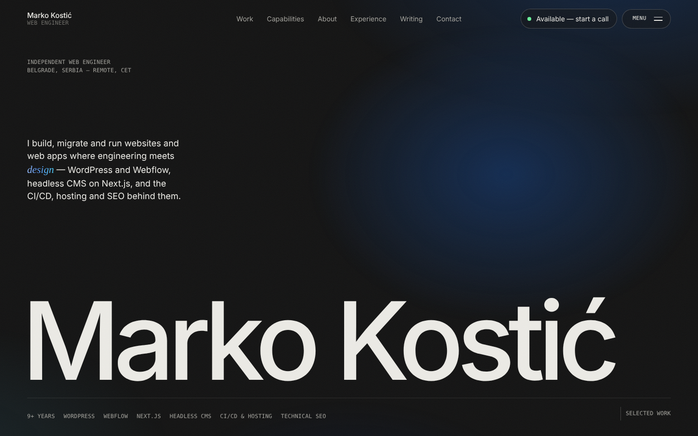

# Marko Kostić — Portfolio

Personal portfolio of Marko Kostić, independent web engineer.
Next.js 16 (App Router, static export) for the site, Sanity Studio v5 for projects and the blog,
Cloudflare Workers for hosting (static assets) and the "Start a project" form API.

Live: https://mkweb-dev.com



## Stack

| Part | Technology |
| --- | --- |
| Site | Next.js 16, React 19, TypeScript, CSS (tokens + CSS Modules) |
| Motion | GSAP 3.13 (ScrollTrigger, SplitText), @gsap/react, Lenis, Three.js |
| Content | Sanity (projects, blog) with a local TypeScript fallback (`web/src/content`) |
| Forms | Cloudflare Worker `POST /api/inquiry` → email via Resend (honeypot, server-side validation) |
| CMS | Sanity Studio v5, hosted on `*.sanity.studio` |
| Hosting | Cloudflare Workers static assets (free, unlimited static requests) + Workers Builds from GitHub |
| CI | GitHub Actions: typecheck, lint, unit tests, build |

## Repository layout

```
mk-portfolio/
├── web/              Next.js site (static export → web/out)
│   ├── worker/       Cloudflare Worker (form API)
│   └── wrangler.jsonc
├── studio/           Sanity Studio (schemas: project, post, category, blockContent)
└── .github/          CI workflow
```

## Getting started

Requirements: Node.js 22 LTS (Next.js 16 needs ≥ 20.9), npm 10, a free Sanity account.

```bash
# 1. Site
cd web
cp .env.example .env.local      # fill in NEXT_PUBLIC_SANITY_PROJECT_ID
npm install
npm run dev                     # http://localhost:3000

# 2. Studio (second terminal)
cd studio
cp .env.example .env
npm install
npm run dev                     # http://localhost:3333
```

Without a Sanity project ID the site still builds: the blog shows the planned topics from `web/src/content/posts.ts`.

## Scripts (web)

| Script | What it does |
| --- | --- |
| `npm run dev` | Dev server with Turbopack |
| `npm run build` | Static export to `web/out` |
| `npm run typecheck` | `tsc --noEmit` |
| `npm run lint` | ESLint |
| `npm test` | Unit tests (`node --test` via tsx) |
| `npm run seed:projects` | Export `content/projects.ts` → `studio/seed/projects.ndjson` |
| `npm run cf:dev` | Build, then run site + Worker locally with Wrangler |
| `npm run cf:deploy` | Manual deploy with Wrangler (normally Workers Builds does this) |

## Deploy

Step-by-step guide (Serbian): `docs/CLOUDFLARE.md`. Short version:

1. Cloudflare → Workers & Pages → Create → Import a repository → this repo.
   Root directory `web`, build command `npm run build`, deploy command `npx wrangler deploy`.
   The Worker name must be `mkweb-dev` (same as `name` in `web/wrangler.jsonc`).
2. Build variables: `NEXT_PUBLIC_SITE_URL`, `NEXT_PUBLIC_SANITY_PROJECT_ID`, `NEXT_PUBLIC_SANITY_DATASET`.
3. Worker → Settings → Variables and Secrets → secret `RESEND_API_KEY`.
4. Worker → Settings → Builds → Deploy Hooks → create one; paste it into a Sanity webhook (filter `_type in ["post", "project"]`).
5. Custom domains: `mkweb-dev.com` (and `www`, redirected to the apex).
6. Studio: `cd studio && npx sanity deploy`.

## Managing projects

Projects live in Sanity once at least one project document exists; until then the site uses `web/src/content/projects.ts`.

```bash
cd web && npm run seed:projects        # writes studio/seed/projects.ndjson
cd ../studio && npm run import:projects # uploads the 18 existing case studies
```

Then add or edit projects in the Studio: `order` controls position (10, 20, 30 … leave gaps), `featured` puts a project in "Selected case studies", `cover` replaces the generated visual with a real screenshot.

## "Start a project" form

`web/src/content/inquiry.ts` holds the questions. The browser and the Worker (`web/worker/index.ts`) import the same validation from `web/src/lib/inquiry.ts`, so the rules cannot drift apart. The Worker emails each brief via Resend with `Reply-To` set to the client. Without JavaScript the form still posts and the Worker redirects to `/thanks/`. Test locally with `npm run cf:dev` — `next dev` has no Worker.

## License

Code: MIT. Content (texts, case studies): © Marko Kostić.
